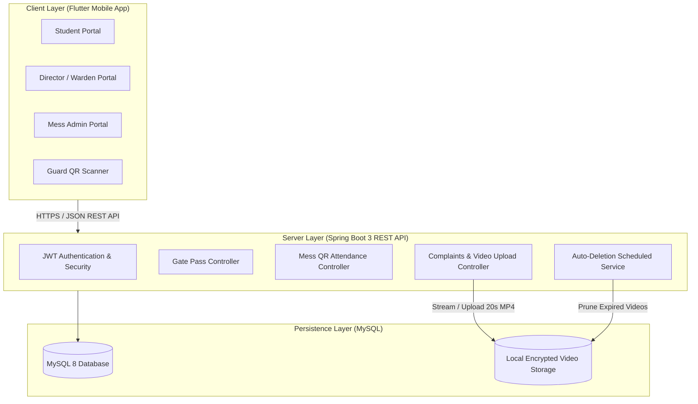

# 🏢 PMV Hostel Management System & Mobile App

[](https://flutter.dev)
[](https://spring.io/projects/spring-boot)
[](https://www.oracle.com/java/)
[](https://www.mysql.com/)
[](https://opensource.org/licenses/MIT)

A modern, production-ready, full-stack **Hostel Management Ecosystem** engineered to automate hostel operations, student safety, mess administration, and student complaint tracking with a cross-platform Flutter mobile application and a Spring Boot REST backend.

---

## 🌟 Key Highlights & Features

### 1. 🎫 Digital Gate Pass & Live Approval Workflow
- Students can submit outgoing gate pass requests with reason, destination, and expected departure/return times.
- Real-time Warden & Director authorization dashboard.
- Security guard validation interface for physical campus check-in and check-out.

### 2. 🍽️ High-Speed QR Mess Attendance
- Dynamic QR code generation for student meal authentication.
- Instant camera scanning for mess staff (Breakfast, Lunch, Snacks, Dinner).
- Prevents double-entry and provides real-time mess scan analytics.

### 3. 📹 Complaint Portal with 20-Second Video Proof
- Students can lodge category-specific complaints (Food Quality, Room Maintenance, Wi-Fi, Water/Electricity).
- **Short Video Proof**: Integrated in-app camera recording capped at 20 seconds for clear visual evidence.
- Status tracking (`Submitted`, `In Progress`, `Resolved`).

### 4. 🧹 Intelligent Video Auto-Pruning Engine
- An automated Spring Boot background scheduler monitors complaint video attachments.
- Once viewed by hostel administrators, video proofs are **automatically deleted from server storage within 24–48 hours** to keep disk usage lightweight and secure.

### 5. 👥 Role-Based Access Control (RBAC)
- Multi-tier JWT authentication with dedicated views:
  - **Student**: Gate passes, meal QR, complaints history, mess menu & ratings.
  - **Hostel Director / Warden**: Gate pass approvals, complaint reviews, student database.
  - **Mess Admin**: Live meal attendance, weekly menu customization, meal ratings.
  - **Campus Guard**: Gate pass verification.

---

## 🏗️ Architecture Overview



---

## 📱 Mobile App (Flutter)

Located in `/mobile_app`

### Tech Stack
- **Framework:** Flutter (Material 3)
- **Language:** Dart
- **Key Plugins:**
  - `mobile_scanner`: High-performance hardware QR scanning.
  - `qr_flutter`: Fast student QR code rendering.
  - `image_picker`: 20-second camera video proof recorder.
  - `http`: Asynchronous REST communications.
  - `url_launcher`: Video proof playback stream.

### Running the App Locally
```bash
cd mobile_app
flutter pub get
flutter run
```

---

## ☕ Backend (Spring Boot)

Located in `/backend`

### Tech Stack
- **Language:** Java 21+
- **Framework:** Spring Boot, Spring Security (JWT)
- **ORM / Persistence:** Spring Data JPA / Hibernate
- **Database:** MySQL 8
- **Scheduled Tasks:** `@EnableScheduling` for video lifecycle management

### Running the Backend Locally
1. Configure your MySQL credentials in `src/main/resources/application.properties` (or set environment variables `DB_URL`, `DB_USER`, `DB_PASSWORD`).
2. Run the application:
```bash
cd backend
./mvnw clean spring-boot:run
```

---

## 📦 Download Production APK

The pre-compiled release APK for Android can be downloaded directly from the **[Releases](../../releases)** tab of this repository.

---

## 🏛️ Campus Leadership & Development Credits

- **Chairman:** Vijay Pal Nain
- **Hostel Director:** Vijay Rana
- **Mess Admin:** Jitesh Kumar
- **Engineered & Developed by:** **Jitesh Kumar** & **Nilaaksh Kalwale**

---

## 📄 License
This project is licensed under the [MIT License](LICENSE).
